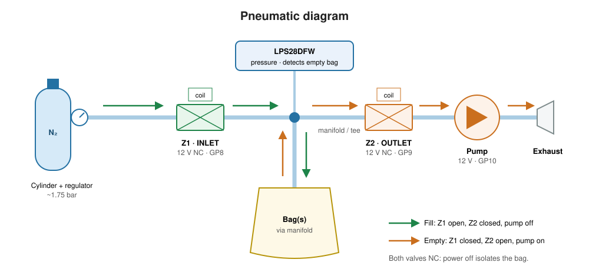
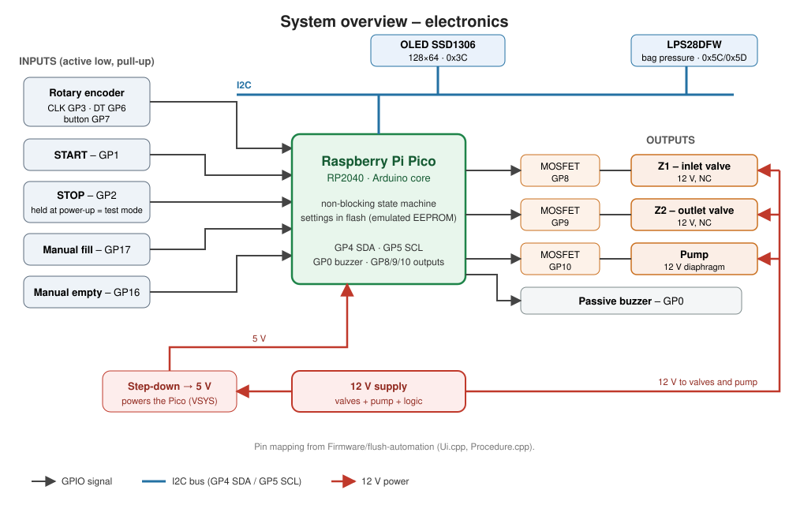
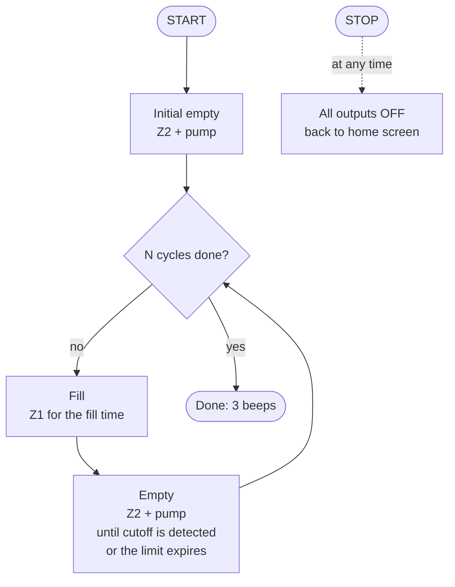
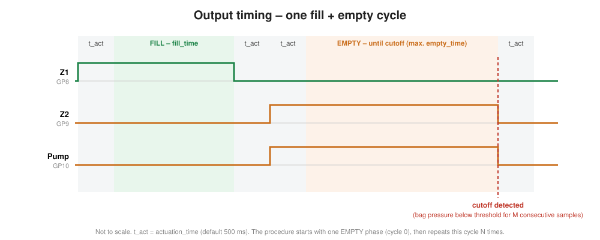

# GANDALF

**G**as-bag **A**utomated **N**itrogen **D**isplacement **A**nd **L**ab **F**lushing

A controller that automatically flushes gas-sampling bags with nitrogen. It
repeats a **fill the bag → empty the bag with a pump** cycle a set number of
times. The end of emptying is detected from the pressure drop in the bag
(LPS28DFW sensor). It is operated locally with an OLED display, a
rotary encoder and buttons. Settings are stored in the Raspberry Pi Pico's
flash memory.

The original firmware was written by **Kamil Widzyk**, a student at AGH
University of Krakow; this version is developed further by Stanislaw Karcz
(see [Authors](#12-authors)).

---

## Table of contents

1. [Quick start](#1-quick-start)
2. [Hardware](#2-hardware)
3. [Procedure](#3-procedure)
4. [User interface](#4-user-interface)
5. [Parameters and ranges](#5-parameters-and-ranges)
6. [End-of-emptying detection](#6-end-of-emptying-detection)
7. [Test mode](#7-test-mode)
8. [Firmware: building and flashing](#8-firmware-building-and-flashing)
9. [Troubleshooting](#9-troubleshooting)
10. [Repository layout](#10-repository-layout)
11. [Safety](#11-safety)
12. [Authors](#12-authors)
13. [License](#13-license)

---

## 1. Quick start

> Read [section 11 (Safety)](#11-safety) before the first run. Nitrogen
> causes asphyxiation without any warning signs.

1. Open the cylinder valve and set the regulator to the supply pressure
   (design value **approx. 1.75 bar**).
2. Connect the bag(s) to the manifold outlet. The fittings must be leak-tight;
   a leak prevents end-of-emptying detection.
3. Switch on the 12 V supply. The buzzer plays a startup melody and the OLED
   shows the home screen.
4. Use the encoder to set:
   - the **number of cycles**,
   - the **fill time** (0.1 s steps),
   - the **maximum empty time** (mm:ss).
5. Press **START**. The procedure first empties the bag, then runs the set
   number of cycles.
6. Completion is signalled by three longer beeps and a return to the home
   screen.
7. **STOP** closes the valves, switches off the pump and aborts the procedure
   at any time.

> Do not disconnect a bag while Z1 is open – nitrogen would vent straight into
> the room.

---

## 2. Hardware

### 2.1 Pneumatics



| Component | Function | Driven by |
| --- | --- | --- |
| Z1 (INLET) | Lets nitrogen into the bag | GP8 via MOSFET |
| Z2 (OUTLET) | Connects the bag to the pump | GP9 via MOSFET |
| 12 V pump | Draws gas out of the bag to the exhaust | GP10 via MOSFET |
| LPS28DFW | Pressure at the bag node, detects end of emptying | I2C |

Both valves are normally closed (NC). After a power loss the bag is isolated
from both the cylinder and the pump.

> The firmware in `Firmware/` is for the **two-valve** version (Z1, Z2). A
> three-valve version with a buffer and a 0.4 mm nozzle is being developed in
> the separate `Air-flushing-automation-v2` repository.

### 2.2 Electronics



- **MCU:** Raspberry Pi Pico (RP2040), Arduino core `rp2040:rp2040:rpipico`
  (earlephilhower/arduino-pico).
- **Display:** SSD1306 OLED 128×64, I2C.
- **Inputs:** rotary encoder with push button, START, STOP, manual fill,
  manual empty.
- **Outputs:** Z1, Z2 and the pump via MOSFET switches; passive buzzer.
- **Sensor:** LPS28DFW absolute pressure sensor, I2C.
- **Power:** 12 V for the valves and pump; the Pico is powered from a DC-DC
  converter.
- **Schematic and PCB:** `Schematic/air-flushing-controller.epro2`
  (EasyEDA Pro).

### 2.3 GPIO map

| GPIO | Direction | Function |
| --- | --- | --- |
| GP0 | output | Buzzer (PWM / `tone`) |
| GP1 | input, pull-up | **START** button |
| GP2 | input, pull-up | **STOP** button (held at power-up = test mode) |
| GP3 | input, pull-up | Encoder CLK |
| GP4 | I2C SDA | OLED, LPS28DFW |
| GP5 | I2C SCL | OLED, LPS28DFW |
| GP6 | input, pull-up | Encoder DT |
| GP7 | input, pull-up | Encoder push button |
| GP8 | output | **Z1**, fill |
| GP9 | output | **Z2**, empty |
| GP10 | output | **Pump** |
| GP16 | input, pull-up | Manual **empty** button |
| GP17 | input, pull-up | Manual **fill** button |

All buttons are active low (they short the input to GND).

### 2.4 I2C bus

| Device | Address | Notes |
| --- | --- | --- |
| SSD1306 (OLED) | `0x3C` | |
| LPS28DFW | `0x5C` (SA0 = GND) or `0x5D` (SA0 = VDD) | address auto-detected, `WHO_AM_I = 0xB4` |

---

## 3. Procedure

After START the controller first empties the bag (cycle 0), then runs `N`
fill + empty cycles. Every valve change is separated by the **actuation time**
(`actuation_time`, default 500 ms) so the valve can fully open or close.



One cycle step by step:



| Step | Z1 | Z2 | Pump | Duration |
| --- | :-: | :-: | :-: | --- |
| Z1 actuation | ● | | | `actuation_time` |
| Fill | ● | | | `fill_time` (0.1 s) |
| Pause | | | | `actuation_time` |
| Z2 actuation | | ● | ● | `actuation_time` |
| Empty | | ● | ● | until cutoff, max. `empty_time` |
| Pause | | | | `actuation_time` |

Emptying ends **early** when the sensor detects that the bag is empty
(section 6). `empty_time` is only a safety limit.

The progress bar on the status screen is relative to the **maximum
duration**: `2·t_act + t_empty + N·(4·t_act + t_fill + t_empty)`. If cutoffs
are detected early, the procedure finishes before the bar is full.

### Buzzer signals

| Event | Signal |
| --- | --- |
| Power-up | short melody (4 tones) |
| START and start of each cycle | one short beep |
| Encoder turn / press | short click |
| Value out of range | error beep |
| Normal completion | 2 × 333 ms + 1 × 500 ms (2 kHz) |
| STOP | series of fast short beeps |

---

## 4. User interface

### 4.1 Home screen

Turning the encoder moves the cursor through four fields:
**cycles → fill time → empty time → settings**.

| Action | Result |
| --- | --- |
| Press on a field | start editing (field is highlighted) |
| Turn while editing | change the value |
| Press while editing | confirm and save |
| Empty time | 1st press edits **minutes** (±60 s), 2nd press **seconds** (±1 s), 3rd press confirms |
| START / STOP | start / abort the procedure |
| Manual buttons | while held: fill (Z1) or empty (Z2 + pump) |

Pressing both manual buttons at once activates no output. After returning
from another screen, the manual buttons are locked until released.

**Bag status icon.** The bottom-right corner of the home screen always shows
one of three icons:

| Icon | Meaning | Shown after |
| :-: | --- | --- |
| ⚠ | the bags need flushing | power-up or reset (including a watchdog reset), any use of the manual fill or empty button, START |
| ✓ | all cycles completed | the procedure finished normally |
| ✗ | the procedure was aborted; the bags may not be fully flushed | STOP during a procedure |

The usual sequence is: START → ✓, pump the bags out manually → ⚠, connect
new bags, START again. The controller cannot detect a bag change by itself:
if the bags are swapped without pressing a manual button, the previous ✓ or ✗
stays on the screen.

### 4.2 Settings menu

| Item | Action |
| --- | --- |
| Back | return to the home screen |
| Max. fill time | 1–100 s, upper limit for the fill time |
| Max. empty time | 1 s – 99 min 59 s (mm:ss), upper limit for the empty time |
| Restart | software reset after confirming `YES` |

### 4.3 Status screen

The status screen shows the current phase (emptying or filling),
cycle number `n/N`, elapsed time and a progress bar.

---

## 5. Parameters and ranges

All parameters are stored in emulated EEPROM (RP2040 flash) 750 ms after the
last change.

| Parameter (`config.`) | Default | Range | Unit | Set in |
| --- | ---: | --- | --- | --- |
| `cycles` | 1 | 1–99 | cycles | home screen |
| `fill_time` | 50 (= 5.0 s) | 1 – `max_fill_time·10` (≤ 999) | 0.1 s | home screen |
| `max_fill_time` | 100 | 1–100 | s | settings |
| `empty_time` | 30 | 1 – `max_empty_time` | s | home screen |
| `max_empty_time` | 30 | 1–5999 | s | settings |
| `actuation_time` | 500 | 1–60000 | ms | code only |
| `pressure_cutoff_hpa` | 850 | 260–1260 | hPa | test mode, p. 3 |
| `cutoff_confirm_samples` | 10 (= 1 s) | 1–50 | samples every 100 ms | test mode, p. 3 |

**Consistency rule:** `empty_time ≤ max_empty_time` and
`fill_time ≤ max_fill_time·10`. A record that breaks this rule is rejected at
startup and replaced with the defaults (see section 9).

Record format: magic `0x43464731`, version **9**, size, configuration fields,
CRC-32. Version 8 and 7 records (firmware with the pump-current sensor) are
migrated automatically at startup: the cycle, time and pressure settings are
kept and the current-sensor fields are dropped. A version 7 record stored the
empty time in tenths of a second, so it is reset to the default. Older
records are replaced with the defaults.

---

## 6. End-of-emptying detection

While the bag is being emptied, the LPS28DFW pressure at the bag node is
sampled every 100 ms. A cutoff occurs when the pressure stays **below
`pressure_cutoff_hpa`** for `cutoff_confirm_samples` consecutive samples. By
default that means 10 samples (1 s) below 850 hPa, roughly 160 hPa below
atmospheric pressure: the pump is pulling on an empty bag. The cutoff ends the
empty step immediately and the procedure moves on.

A failed reading resets the sample counter. If the sensor does not respond,
no cutoff is detected and every empty step ends at the `empty_time` limit.

---

## 7. Test mode

**Entering:** power up with **STOP held**. The encoder switches pages. The
manual fill and empty buttons work on every page.

| Page | Content |
| --- | --- |
| 1 – `TEST MODE` | Sensor status, live pressure (LPS28DFW), manual control |
| 2 – `PRESSURE` | Pressure, threshold, below-threshold sample counter, cutoff state |
| 3 – `PARAMETERS` | Editing of the cutoff parameters `THRESHOLD[hPa]` and `CUTOFF SAMPLES` |

**Parameter editing (p. 3):**
1. A press enters field selection. Turning moves the cursor; the last entry is
   `BACK`.
2. A press selects a field for editing. Turning changes the value: pressure by
   1 hPa (10 hPa when turning fast), samples by 1.
3. A press saves the value and applies it immediately. **STOP** cancels the
   edit.

---

## 8. Firmware: building and flashing

Requirements: [arduino-cli](https://arduino.github.io/arduino-cli/), the
`rp2040:rp2040` core (earlephilhower) and the Adafruit SSD1306, Adafruit GFX
and Adafruit BusIO libraries.

**Windows:**
```bat
cd Firmware\flush-automation
install.bat    :: one-time: RP2040 core + libraries
compile.bat    :: builds build\flush-automation.ino.uf2
```

**Linux / macOS:**
```bash
cd Firmware/flush-automation
arduino-cli config add board_manager.additional_urls \
  https://github.com/earlephilhower/arduino-pico/releases/download/global/package_rp2040_index.json
arduino-cli core update-index && arduino-cli core install rp2040:rp2040
arduino-cli lib install "Adafruit SSD1306" "Adafruit GFX Library" "Adafruit BusIO"
arduino-cli compile --fqbn rp2040:rp2040:rpipico --output-dir build .
```

**Flashing:** hold BOOTSEL on the Pico, plug in USB and copy
`build/flush-automation.ino.uf2` to the `RPI-RP2` drive.

Alternatively, flash with arduino-cli. BOOTSEL is only needed the first time;
afterwards the running firmware accepts uploads over USB:
```bash
arduino-cli board list    # find the Pico's port, e.g. /dev/cu.usbmodem1101
arduino-cli upload --fqbn rp2040:rp2040:rpipico -p <port> --input-dir build
```

**Changing `actuation_time`:** it has no screen editor. Change the sixth value
of `defaultConfig` in `Firmware/flush-automation/Ui.cpp` (default `500` ms).
The new default only applies when the stored record is replaced with the
defaults; otherwise the value already saved in EEPROM is kept.

> Flashing new firmware does not erase the settings, because the emulated
> EEPROM lives in a separate flash sector. If the record version changes, the
> settings are migrated on the first boot.

The firmware architecture (modules, main loop, state machine) is described in
the [firmware README](./Firmware/flush-automation/README.md).

---

## 9. Troubleshooting

| Symptom | Likely cause | What to do |
| --- | --- | --- |
| Settings revert to defaults after a power cycle | Firmware before the fix: its defaults (empty time 300 s, maximum 30 s) broke the `empty_time ≤ max_empty_time` rule, so the stored record was rejected at every boot. | Flash the current firmware. The old record is migrated and the empty time is clamped to its maximum, so the settings are kept. |
| Emptying always takes the full `empty_time` | No pressure reading, a leak in the bag line, or the pressure threshold is too low | Test mode, p. 1 and 2: check the pressure reading and whether it drops below the threshold when the pump runs |
| Emptying ends too early | Pressure threshold too high or too few confirming samples | Lower `THRESHOLD` or increase `CUTOFF SAMPLES` |
| The bag does not fill | Cylinder closed, regulator pressure too low, Z1 not working | Test mode, p. 1: press the fill button and listen for the valve click |
| No pressure reading | LPS28DFW does not respond on I2C | Check the SDA/SCL wiring and the sensor supply. The firmware retries detection automatically. |
| Blank screen at power-up | I2C fault, or the OLED uses an address other than `0x3C` | Check the wiring and the module address |
| Manual button does nothing after a screen change | Safety lockout | Release the button and press it again |

---

## 10. Repository layout

| Path | Content |
| --- | --- |
| `README.md` | This document |
| `docs/` | Diagrams (SVG) and OLED screen previews used in this README |
| `Firmware/flush-automation/flush-automation.ino` | `setup()` / `loop()`, I2C access for the sensor drivers |
| `Firmware/flush-automation/Ui.*` | Screens, encoder, buttons, `Config` and its defaults |
| `Firmware/flush-automation/Procedure.*` | Procedure state machine, outputs, pressure cutoff detection, buzzer |
| `Firmware/flush-automation/ConfigStore.*` | Saving, validating and migrating the configuration in EEPROM |
| `Firmware/flush-automation/Lps28dfw.*` | Pressure sensor driver |
| `Firmware/flush-automation/*Bitmaps.h` | Screen bitmaps |
| `Firmware/flush-automation/UI/` | PNG previews of the screen bitmaps (128×64) and the digit font |
| `Firmware/flush-automation/install.bat`, `compile.bat`, `libraries.txt` | Dependency installation and build |
| `Firmware/flush-automation/diagram.json`, `wokwi.toml` | Wokwi simulation from an early stage (does not fully reflect the hardware) |
| `Schematic/air-flushing-controller.epro2` | Schematic and PCB (EasyEDA Pro) |

---

## 11. Safety

This section lists the main hazards of the setup. It does not replace the
lab's safety rules or the gas supplier's safety data sheet (SDS).

### 11.1 Nitrogen: asphyxiation

- Nitrogen is colourless, odourless and non-toxic, but it **displaces oxygen**.
  Breathing oxygen-deficient air gives no warning (no breathlessness, no
  smell); at very low oxygen levels a person can lose consciousness within
  seconds.
- Every empty step **pumps nitrogen out of the bag into the room** through the
  pump exhaust. Route the exhaust into a fume hood or extraction line, or run
  the setup only in a well-ventilated room.
- In a small or poorly ventilated room, use an **oxygen monitor** (alarm
  below 19.5 % O₂).
- Close the cylinder valve when the setup is not in use, and before
  disconnecting tubing upstream of Z1.

### 11.2 Cylinder and pressure

- Keep the cylinder **upright and secured** (chain or strap). Move it only on
  a cylinder trolley with the valve cap fitted.
- Use a regulator rated for nitrogen and the cylinder pressure. Do not raise
  the outlet pressure above the design value (approx. 1.75 bar) without
  checking the rating of the valves, tubing and bags.
- **An overfilled bag can burst.** Set `fill_time` for the bag size
  (fill one bag with the manual fill button first to find the time) and keep `max_fill_time` as low as practical so a wrong entry
  cannot overfill the bag.
- Check new or reconnected fittings for leaks with leak-detection solution.
  A leak also prevents end-of-emptying detection (section 6).

### 11.3 Controller behaviour

- **STOP is handled by the firmware.** It is not an emergency stop. To stop
  the setup in an emergency, **close the cylinder valve and disconnect the
  12 V supply**.
- **Hardware watchdog:** if the main loop stops running for 2 s (firmware
  hang, stuck I2C bus), the RP2040 resets. During the reset the GPIOs return
  to inputs, and the first thing `setup()` does is drive Z1, Z2 and the pump
  outputs low, so all transistors stay off. After a watchdog reset the
  controller starts on the home screen; an interrupted procedure is **not**
  resumed.
- Both valves are normally closed, so a power loss isolates the bag from the
  cylinder and from the pump.
- The manual fill and empty buttons drive the outputs directly for as long as
  they are held, including in test mode, without the procedure's time limits.

---

## 12. Authors

This project is based on
[Kamil4567/Air-flushing-automation](https://github.com/Kamil4567/Air-flushing-automation);
the commit history of the original repository is preserved here.

- **Kamil Widzyk** (student, AGH University of Krakow): original author of the
  firmware, hardware design and UI.
- **Stanislaw Karcz**: further development of this version:
  - pressure-only end-of-emptying detection (INA219 current sensor removed),
    settings record v9 with migration, fix for settings being reset at boot
  - hardware watchdog that keeps the valves and pump off after a reset
  - bag status icon on the home screen (needs flushing / done / stopped),
    simplified settings menu
  - English UI, code and documentation, safety section

---

## 13. License

Copyright (C) 2026 Kamil Widzyk, Stanislaw Karcz

This project is free software: you can redistribute it and/or modify it under
the terms of the GNU General Public License as published by the Free Software
Foundation, either version 3 of the License, or (at your option) any later
version. See [LICENSE](LICENSE) for the full text.

This program is distributed in the hope that it will be useful, but WITHOUT
ANY WARRANTY; without even the implied warranty of MERCHANTABILITY or FITNESS
FOR A PARTICULAR PURPOSE.
